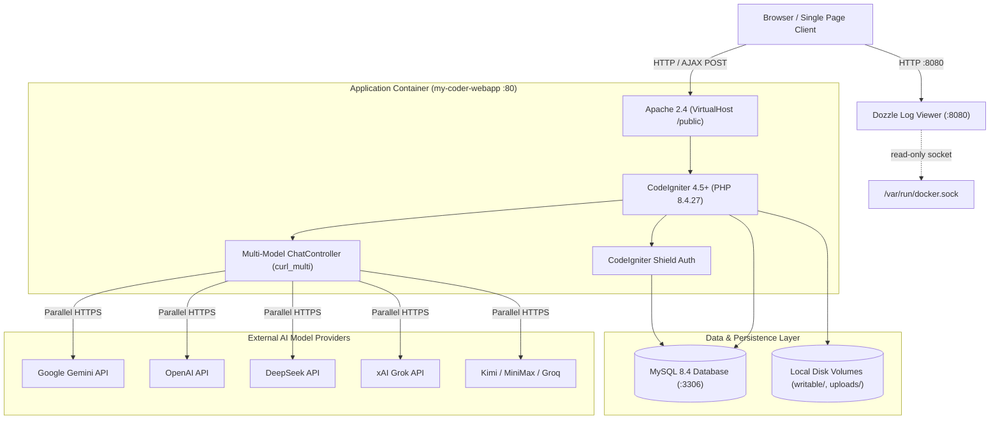

# 🛠️ Engineering Documentation

Welcome to the **My Coder WebApp** engineering documentation. This directory is written specifically for software engineers and architects who need to understand, maintain, test, and evolve the platform.

If you only need to **run or operate** the platform, refer to the root [README.md](../README.md).

---

## 🗺️ Navigation

| I want to… | Resource | Description |
|---|---|---|
| **Run without coding** | [../README.md](../README.md) | 1-click Docker deployment and operator run instructions |
| **Understand the Architecture** | [architecture/overview.md](architecture/overview.md) | C4 container model, network topology, and trust boundaries |
| **Inspect Service Communication** | [architecture/communication.md](architecture/communication.md) | Multi-model parallel inference flow & sequence diagrams |
| **Inspect Data & Storage** | [architecture/data-and-storage.md](architecture/data-and-storage.md) | MySQL schema, API key encryption, and Redis/MinIO analysis |
| **Explore the REST API** | [api/openapi.yaml](api/openapi.yaml) | Full OpenAPI 3.0 specification for all REST endpoints |
| **Work on CodeIgniter 4** | [services/codeigniter.md](services/codeigniter.md) | Controllers, Shield auth, routes, and Spark CLI |
| **Set Up Native Development** | [engineering/local-development.md](engineering/local-development.md) | Developing locally without container rebuild overhead |
| **Add Features Safely** | [engineering/making-changes.md](engineering/making-changes.md) | Developer recipe task table and Definition of Done (DoD) |
| **Container Operations** | [runbooks/restart.md](runbooks/restart.md) | Graceful restarts, clean rebuilds, and nuclear resets |
| **Disaster Recovery** | [runbooks/backup-and-restore.md](runbooks/backup-and-restore.md) | Database dump automation and avatar asset restore |
| **Review Architectural Decisions** | [adr/0001-multi-model-master-synthesis.md](adr/0001-multi-model-master-synthesis.md) | ADR: Multi-model parallel fan-out and master synthesis |

---

## 🏗️ System Overview

