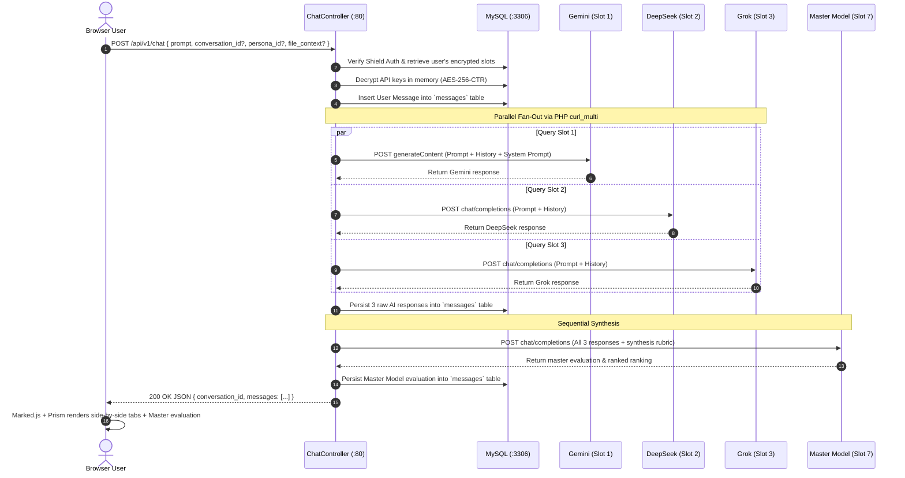

# Architecture: Communication & Sequence Flows

## 1. Inter-Service Communication Table

| Source | Destination | Protocol / Transport | Authentication | Base URL / Address | Purpose |
|---|---|---|---|---|---|
| **Browser Client** | `my-coder-webapp` | HTTP/1.1 (JSON / AJAX) | Shield Session Cookie + `X-CSRF-TOKEN` | `http://<host>/api/v1/` | Chat prompts, settings, conversation retrieval |
| **Browser Client** | `shared-dozzle` | HTTP/1.1 (WebSockets / SSE) | None (LAN access) | `http://<host>:8080/` | Container log streaming |
| `my-coder-webapp` | `shared-mysql` | TCP (MySQL Wire Protocol) | Native MySQL credentials (`root`) | `mysql:3306` | Relational data persistence & migrations |
| `my-coder-webapp` | **Google Gemini** | HTTPS REST | Query Parameter API Key | `https://generativelanguage.googleapis.com` | Model inference & reasoning |
| `my-coder-webapp` | **OpenAI** | HTTPS REST | `Bearer <API_KEY>` Header | `https://api.openai.com/v1/` | Model inference |
| `my-coder-webapp` | **DeepSeek** | HTTPS REST | `Bearer <API_KEY>` Header | `https://api.deepseek.com/v1/` | Model inference & reasoning |
| `my-coder-webapp` | **xAI Grok** | HTTPS REST | `Bearer <API_KEY>` Header | `https://api.x.ai/v1/` | Model inference |

---

## 2. Multi-Model Chat Execution Sequence

The core flow of `POST /api/v1/chat` illustrates how user prompts fan out in parallel and get synthesized:

