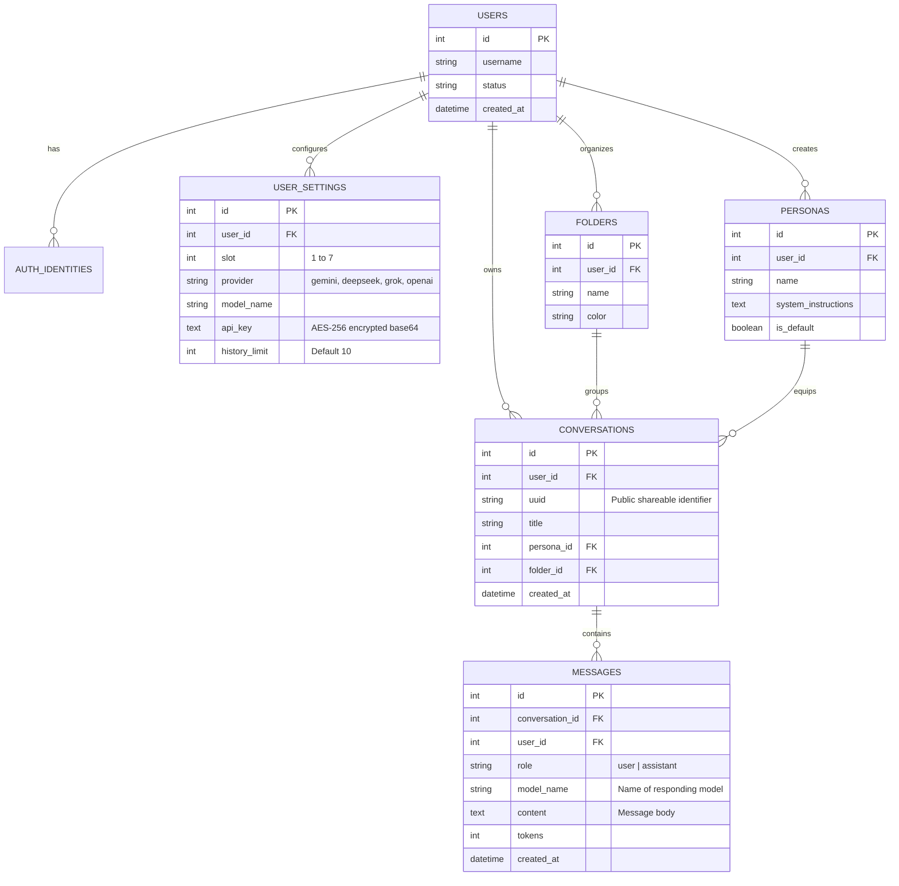

# Architecture: Data & Storage

## 1. Database Schema & Models

All database tables are versioned and managed through CodeIgniter 4 migrations located in `app/Database/Migrations/`.

---

## 2. In-Memory Database (Redis) & Object Storage (MinIO) Analysis

### Redis Assessment
- **Current State**: File-based storage handles sessions in `writable/session` and throttle state in `writable/cache`.
- **Production Recommendation**:
  - For single-container instances, file-based is lightweight and self-contained.
  - When scaling to multiple container replicas, migrate sessions to `CodeIgniter\Session\Handlers\RedisHandler` to prevent session desynchronization.
  - Adding Redis also allows implementing prompt response caching (hashing `md5($prompt . $persona_id)` with a 24-hour TTL) to eliminate redundant API calls to expensive models.

### MinIO (Object Storage) Assessment
- **Current State**: File uploads attached in chat prompts are converted client-side to text context using browser `FileReader` and injected directly into the prompt payload. Files are not saved on disk. User profile avatars are saved locally to `public/uploads/avatars/`.
- **Production Recommendation**:
  - MinIO is **not required** for the current text-based workflow.
  - MinIO becomes necessary when supporting **multi-modal vision/audio models** where binary media (PDFs, high-resolution imagery, audio clips) must be persisted, indexed, and served via presigned URLs.
