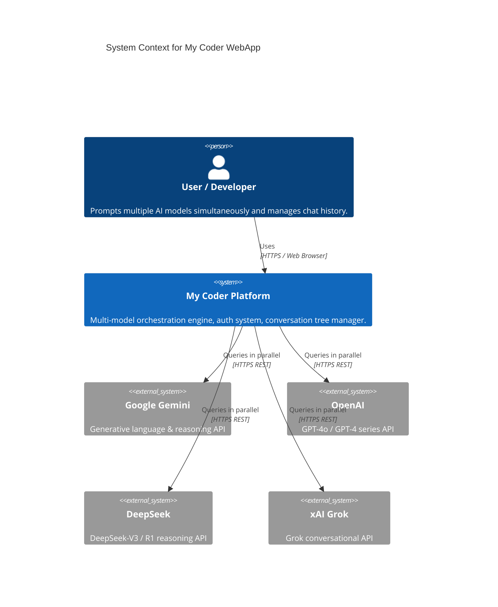

# Architecture: System Overview

## 1. System Context

**My Coder WebApp** is a multi-model AI orchestration platform built on CodeIgniter 4 (PHP 8.4) and MySQL 8.4. It enables users to configure distinct AI models across dedicated slots, dispatch unified prompts concurrently, and receive a synthesized Master Model evaluation that grades and ranks the results.

---

## 2. Container Architecture

The platform runs as a 3-container topology defined in `docker-compose.yml`:

| Container Name | Service | Base Image | Host Port | Internal Port | Responsibility |
|---|---|---|---|---|---|
| `my-coder-webapp` | `my-coder` | `php:8.4.27-apache` | `80` | `80` | Web application, REST API, auth filters, multi-curl AI orchestrator |
| `shared-mysql` | `mysql` | `mysql:8.4` | `3306` | `3306` | Relational storage for users, encrypted API keys, messages, conversations |
| `shared-dozzle` | `dozzle` | `amir20/dozzle:latest` | `8080` | `8080` | Real-time container log viewer and container performance telemetry |

---

## 3. Trust Boundary & Security Architecture

1. **Client $\rightarrow$ Server Boundary**:
   - Authentication is governed by **CodeIgniter Shield** session filters.
   - All state-changing requests (`POST`, `PATCH`, `DELETE`) require a valid CSRF token header (`X-CSRF-TOKEN`) injected into all AJAX payloads.
   - The `/api/v1/chat` route is protected by the `auth-rates` throttling filter to prevent abuse and API quota exhaustion.
2. **Server $\rightarrow$ Database Boundary**:
   - Per-user scoping is strictly enforced: every query in `ConversationModel`, `MessageModel`, `UserSettingModel`, and `FolderModel` verifies `user_id = auth()->id()`.
   - Provider API keys are stored encrypted at rest using CodeIgniter's `Encrypter` (AES-256-CTR) and base64-encoded.
   - Keys are decrypted only into volatile PHP memory during request handling.
3. **Container $\rightarrow$ Docker Daemon Boundary**:
   - `shared-dozzle` mounts `/var/run/docker.sock` strictly in **read-only** mode (`:ro`), preventing any write or execution operations against the host Docker daemon.
